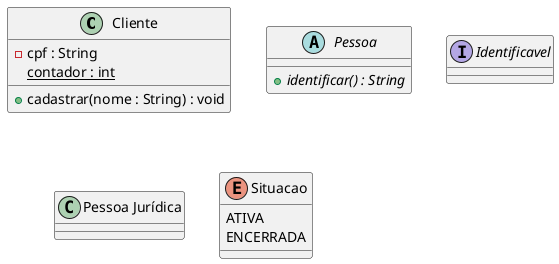
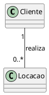
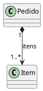

# PlantUML: classes — referência para RAG

Fonte: https://plantuml.com/class-diagram
Consulta: 01/10/2026. Síntese com exemplos próprios; critérios UML são orientações de modelagem.

## Classes, atributos e operações

Visibilidade: `+` pública; `-` privada; `#` protegida; `~` pacote.
Métodos possuem parênteses. Referencie nomes com espaços pelo alias.

## Relações

| Tipo | Sintaxe | Interpretação UML |
|---|---|---|
| Associação | `Cliente -- Locacao` | Vínculo estrutural |
| Associação navegável | `Locacao --> Cliente` | Locação acessa cliente |
| Dependência | `Servico ..> Validador` | Uso pontual |
| Herança | `Pessoa <|-- Cliente` | Triângulo na superclasse |
| Realização | `Identificavel <|.. Cliente` | Triângulo na interface |
| Agregação | `Equipe o-- Pessoa` | Losango vazio no todo |
| Composição | `Pedido *-- Item` | Losango preenchido no todo |

Agregação: partes independentes. Composição: posse exclusiva e ciclo de vida subordinado ao todo. Não deduza composição apenas de “contém”.

## Cardinalidade

Multiplicidades ficam entre aspas nas extremidades:

Cada locação corresponde a um cliente; cada cliente, a zero ou mais locações.
Valores: `1`, `0..1`, `*`, `0..*`, `1..*`, `2..5`.

## Navegabilidade

A seta aponta ao destino acessível; o losango identifica o todo. Sem seta, navegabilidade não especificada. `: realiza >` orienta leitura do rótulo, não navegabilidade.
A navegabilidade "ida e volta" não deve ser compreendida como duas setas vai e vem, e sim como uma relação bidirecional.

## Geração

Use `@startuml`/`@enduml`; declare elementos; preserve aliases; não invente multiplicidades. Recupere seções completas, preservando exemplos.